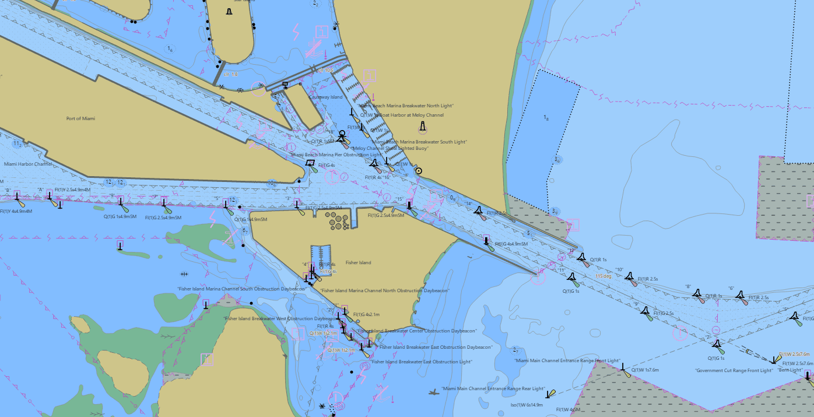
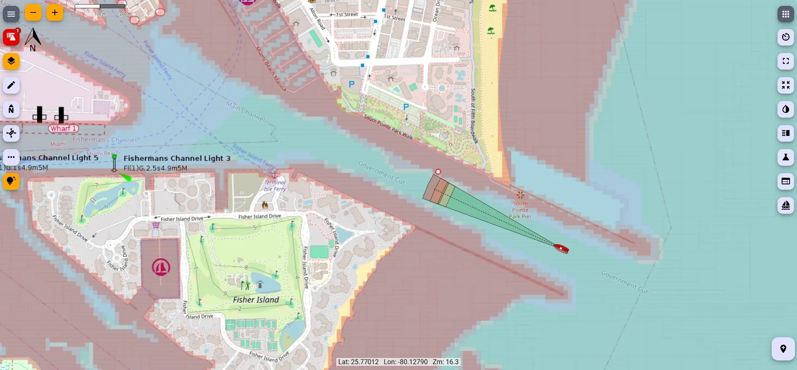

# Signal K Server for Android

A full [Signal K Server](https://github.com/SignalK/signalk-server) on any Android phone or tablet: the real Node.js server, its App Store, plugins and webapps, unmodified.

The APK ships only a Node.js runtime and a bootstrap installer. On first run the app installs `signalk-server` from npm into app-private storage, the same way `npm install -g signalk-server` does on a Pi. Around that it adds what a phone needs and a Pi does not:

- a foreground service that keeps the server alive with the screen off, and restarts it the way systemd would
- A/B upgrades of the server with a health gate and automatic rollback
- USB and Bluetooth serial bridged into Signal K (no root, no `/dev/tty*`), and Bluetooth LE sensors
- the phone's own GNSS, attitude, barometer, battery and cabin sensors as Signal K data
- Signal K alarms as real Android alarms that wake a locked phone
- a helm screen: any webapp on the home screen, a red night filter, dimming, a widget
- the server's offline charts and other mass data on the phone or on an SD card, filled from a
  browser on the boat's network or from a laptop over USB
- encrypted backups of the server's settings, and the app updating itself from this
  repository's Releases

  
  

*Charts as Freeboard-SK draws them from a Signal K server: an S-57 chart (left) and OpenStreetMap
with a depth layer (right).*

Sibling project: [Crew Radio](https://github.com/KEGustafsson/crew-radio), whose service, networking and Signal K client code this app reuses.

## Status

Close to 1.0. Every merge to `main` publishes a signed APK on the [Releases](https://github.com/KEGustafsson/signalk-server-android/releases) page. What has been built but still waits for a test on a phone is listed under "To check on a device" in each step of [docs/PLAN.md](docs/PLAN.md) §16, which is also the plan of record.

## Install

You need a phone or tablet with Android 10 or later and, for the first run, about 90 MB of internet (Wi-Fi is best), or a server package made on a computer (below).

1. On the phone, open the [latest release](https://github.com/KEGustafsson/signalk-server-android/releases/latest) and download **`SignalKServer-<version>-arm64-v8a.apk`**. It fits nearly every phone made since 2017. `SignalKServer-<version>.apk` is larger and runs everywhere else: 32-bit phones, the emulator, ChromeOS.
2. Open the file. Android asks once whether your browser may install apps; allow it, then install.
3. Open **Signal K Server**.

From then on the app updates itself: the Dock's **App update** card offers a newer release, downloads it, checks it against the checksum its release publishes and the key the app is signed with, and hands it to Android's installer. A server that was running starts again after the update.

## First run

A short wizard:

- **Which version.** The newest `signalk-server` npm has, or **From a file (.tgz)** when the boat has no internet: on any computer with Node.js, `npm pack signalk-server` makes that file. The app installs it, then tries the new server on a spare port before it makes it live.
- **What the server needs.** Notifications (the server's own notification and its warnings), Nearby devices (so tablets and plotters on the boat's network reach the server; without it only this phone can), and an unrestricted battery (so Android does not stop the server overnight). Each can also be changed later in the Dock's **Settings** card.
- **Start.** The admin UI opens in the browser at `http://127.0.0.1:3000/admin/`. Set up its security there (an admin user), as on any Signal K server. Plugins and webapps (Freeboard-SK, KIP, and the rest) come from its **App Store**.

## The Dock

The app's one screen. From the top:

- **Server**: running or stopped, Start/Stop/Restart, the address the boat's network reaches it on (`http://<phone's address>:3000`), its uptime, CPU and memory, and how many updates a second it takes in.
- **Webapps**: each installed webapp opens in the browser, and can be pinned to the home screen, where one tap starts a stopped server and opens it.
- **Helm screen**: a red night filter, dimming and keeping the screen on, over every app. A Quick Settings tile, **Night filter**, turns the filter on and off.
- **Power**: **Harbor** (everything), **Passage** (the screen dimmed to the helm screen's brightness) and **Battery saver** (the phone's own sensors stop, except the GNSS at once a second and the battery). Instruments on USB and Bluetooth carry on in all three.
- **Updates**: the server's version, a newer one to install, its release notes, and a rollback to the one before. A new version runs on trial after its update; if it fails to come up, the app rolls back by itself.
- **App update**: the app's own update, above. A switch turns off the daily check.
- **Settings**: what the phone grants the server, and starting it when the phone starts.
- **Sensors**: the phone's sensors in Signal K, and **Level now** for roll and pitch.
- **Serial devices**: USB and Bluetooth instruments.
- **Storage**: whether the server's data lives on the phone or on a card.
- **Backup**: saving and restoring the server's settings.
- **Log**: the server's log, filtered by kind or by words, and **Share diagnostics** for whoever helps you.

There is also a Quick Settings tile, **Signal K**, to start and stop the server, and a home-screen widget, **Boat at a glance**: depth, speed over ground and apparent wind.

## Instruments and the phone's sensors

The app installs its own plugin, **Pocket SK Android bridge**, which carries everything below into Signal K. Its settings are in the admin UI under Server → Plugin Config.

- **USB serial.** GPS and AIS receivers and NMEA 0183 interfaces on a USB adapter with an FTDI, Silicon Labs CP210x, CH340 or Prolific PL2303 chip, or one that is a plain USB serial (CDC) device. Plug it in (a USB OTG adapter on most phones), allow it when Android asks, and set its baud rate in the plugin's settings: 4800 unless set, 38400 for most AIS.
- **Bluetooth serial.** Pair the device in the phone's Bluetooth settings, then switch it on in the **Serial devices** card.
- **Bluetooth LE sensors.** Battery monitors, temperature and humidity sensors and the like reach plugins such as `bt-sensors-plugin-sk` through the phone's own Bluetooth: no BlueZ needed.
- **The phone itself.** Battery, barometer, GNSS position, speed and course, roll, pitch and rate of turn, a magnetic heading (off by default), cabin temperature, humidity and light where the phone has the sensors, and the cellular signal. Each can be switched off or slowed down in the plugin's settings. The GNSS needs **Precise location** allowed.

Each source appears in Signal K as `android.<name>`, so the data browser shows where a value came from.

## Alarms

An alarm or emergency from Signal K (an anchor alarm, a depth alarm) rings with the phone's alarm sound, vibrates, and wakes and fills a locked screen; warnings too, when the bridge plugin's settings ask for them. **Silence** (or **Acknowledge**, for an emergency) goes back to the server. The full-screen alarm needs **Full-screen alarms** allowed on Android 14 and later (the Settings card opens the page); without it the alarm still rings, as a notification.

## Charts and other data

The server's `.signalk` folder (charts, its state, the plugins' data, the logs) lives in the app's own folder on the phone, or on an SD card or USB drive chosen in the **Storage** card. Three ways to fill it:

- **From a browser on the boat's network**: the **Pocket SK files** webapp uploads charts and other files into the server's data folders.
- **From a computer over USB**: `Android/data/fi.pocketsk/files/signalk` on the phone (or the card) is the server's `.signalk`, as on a Linux box. Charts copied there are the server's at once; a settings file changed there is taken in at the server's next start.
- **The USB inbox**: files copied into `Android/data/fi.pocketsk/files/inbox/charts` are moved into the charts when the server starts, or at once with **Take them in**.

## Backups

The **Backup** card saves the server's settings, its users and passwords and the plugins' settings as one zip encrypted with AES-256 and a passphrase you type each time. Save it wherever you like: the phone, a card, Drive, Nextcloud. On a computer, 7-Zip opens it with the passphrase. A restore puts the settings back and installs the plugins again with npm (so it needs the network). Charts and other data are not in the backup; they are in the USB folder.

## Good to know

- **Keep the battery unrestricted.** Some phones stop background apps hard; the **Settings** card's battery row opens the page where the app is set to Don't optimise.
- **GPS after an automatic start.** A server started at boot or from the tile gets no location from Android until it is started again from the app's screen; the **Sensors** card offers that.
- **Plugins with native code.** Android builds of the common native addons (serialport, better-sqlite3, sqlite3, bufferutil, utf-8-validate) are fetched by the app when a plugin needs one. A plugin whose addon has no Android build yet installs, but says so in the install log and will not load.
- **Uninstalling the app deletes the server's data folder** on the phone and the card, as Android does with every app's own folder. Save a backup, and copy the charts off over USB, first.
- **Secrets.** The server's `security.json` is in the USB folder, so anyone who can open the phone's files over USB can read it. The diagnostics bundle leaves the server's settings and security out.

## Build it yourself

Open the folder in Android Studio (a release that supports Android Gradle Plugin 9.4) and build, or run `./gradlew assembleDebug` with an Android SDK (platform 37) and a JDK 17 on the machine. Unit tests: `./gradlew testDebugUnitTest`. Every merge to `main` builds a signed APK and publishes it on the Releases page; the build, signing and release procedure is the one documented for [Crew Radio](https://github.com/KEGustafsson/crew-radio/blob/main/docs/BUILDING.md), with `SIGNALK_ANDROID_` in place of `CREWRADIO_` in the secrets and environment variables. The architecture and every decision behind it are in [docs/PLAN.md](docs/PLAN.md).

## Licence

EUPL-1.2 ([LICENSE](LICENSE)).
