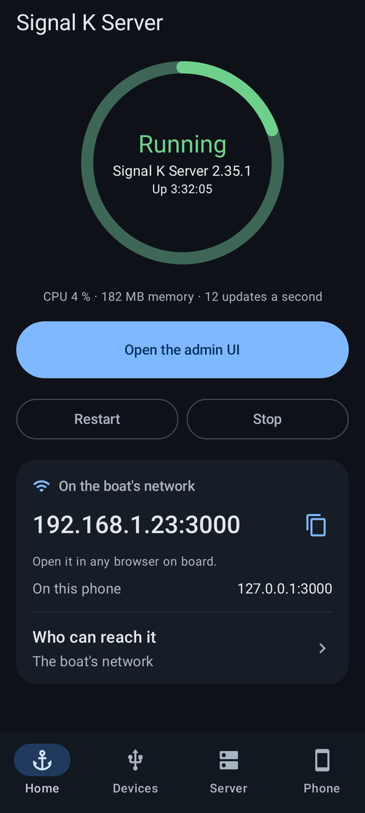
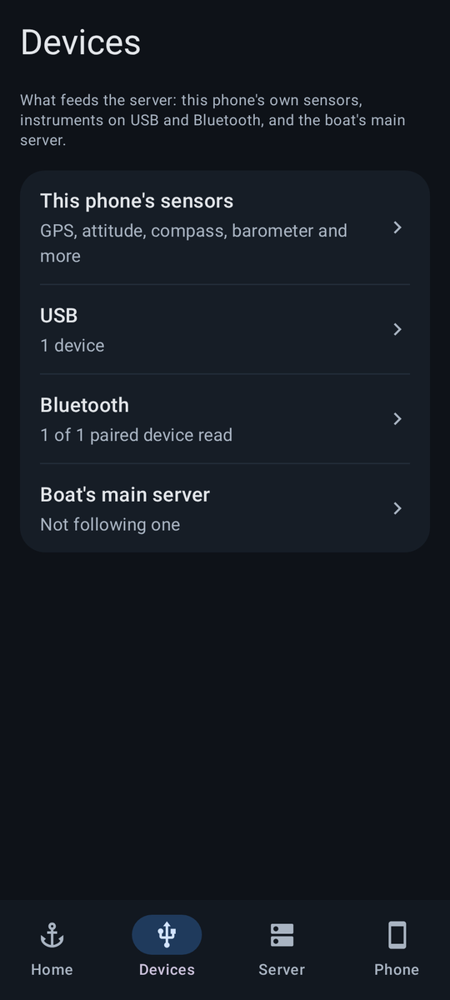
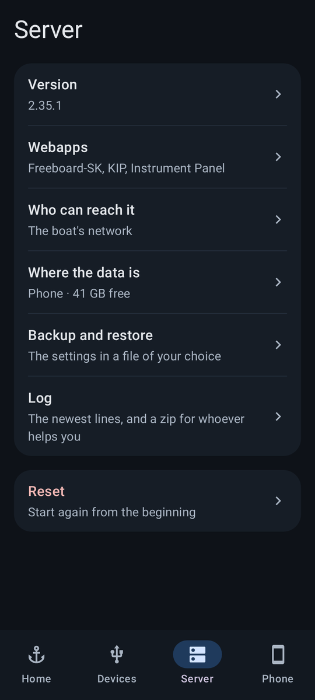
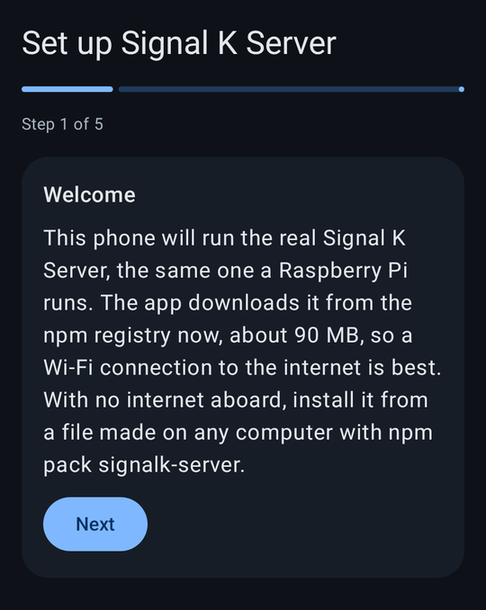
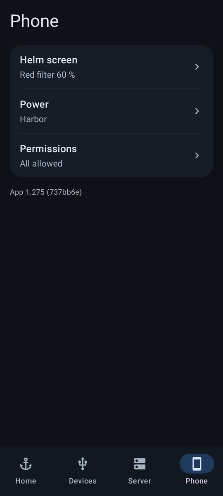
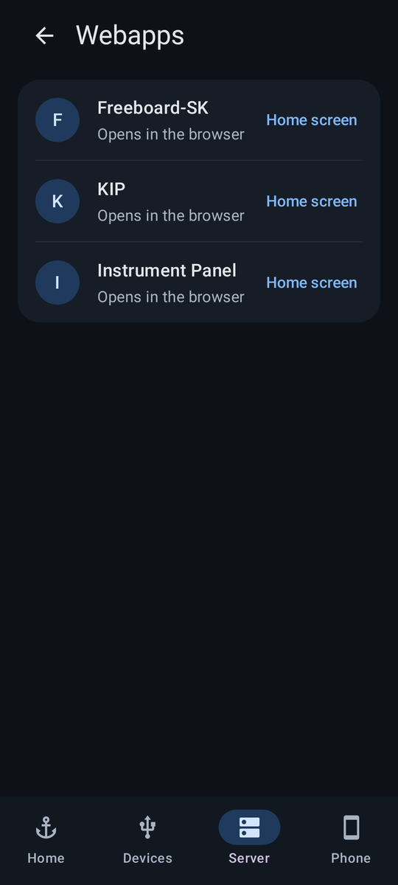
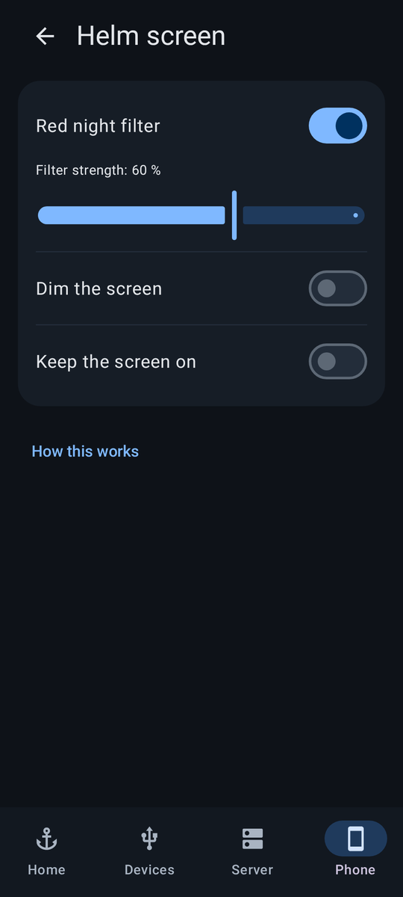
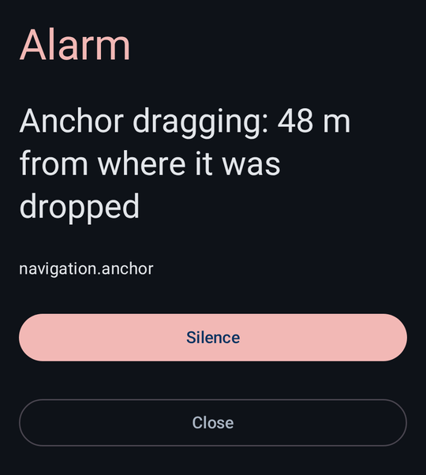

# Signal K Server for Android

**Turn a spare Android phone or tablet into your boat's Signal K server.**

This app runs the real [Signal K Server](https://github.com/SignalK/signalk-server) on the phone: the same server a Raspberry Pi runs, with its admin UI, App Store, plugins and webapps. Around it, the app adds what a phone at sea needs. It keeps the server running with the screen off. It reads instruments plugged in over USB or paired over Bluetooth. It makes the phone's own GPS and sensors part of the boat's data, and it rings Signal K's alarms like a real alarm clock.

  
  
  

## What you can do with it

- **Run a Signal K server with no extra hardware.** A phone is a small computer with its own battery, GPS and Wi-Fi.
- **See the boat's data on every screen aboard.** Tablets, laptops and chart plotters on the boat's Wi-Fi open the server's address in a browser. The app shows that address on its first screen.
- **Connect instruments.** It reads GPS and AIS receivers and NMEA 0183 interfaces on a USB adapter, Bluetooth serial devices, and Bluetooth LE sensors such as Ruuvi tags.
- **Use the phone as a sensor.** Position, speed and course, heel and pitch, the barometer, the battery, and the cabin's temperature and humidity where the phone has those sensors.
- **Hear the alarms.** An anchor alarm or a depth alarm from Signal K wakes the phone, rings and fills the locked screen.
- **Keep charts aboard.** Upload them from a browser, or copy them from a laptop over USB. They can live on the phone or on an SD card.
- **Follow the boat's main server.** If the boat already has a Signal K server, the phone can follow it and send its own sensors there.
- **Stand watch at night.** A red night filter and dimming work over any app, and a Quick Settings tile turns them on.

## What you need

- An Android phone or tablet with **Android 10 or later**. Most phones made since 2017 will do.
- For the first start, about **90 MB of internet**, Wi-Fi if you can. With no internet aboard, a computer can make the server file for you (see [No internet aboard](#no-internet-aboard)).
- Room on the phone for the server, which keeps its current and its previous version, and for your charts.
- The phone on a charger. A server runs all day.

## Install

1. On the phone, open the [latest release](https://github.com/KEGustafsson/signalk-server-android/releases/latest) and download **`SignalKServer-<version>-arm64-v8a.apk`**. It fits nearly every phone made since 2017. If your phone is an older 32-bit one, or you use ChromeOS, take the larger **`SignalKServer-<version>.apk`** instead.
2. Open the downloaded file. Android asks once whether your browser may install apps: allow it, then tap **Install**.
3. Open **Signal K Server**.

The app is published here only, not on Google Play or F-Droid. Updates come to it on their own: when a newer release is out, **Phone → App update** offers it. The app downloads it and checks that it is genuine, then Android asks you to confirm. If you would rather have one app keep all your sideloaded apps current, [Obtainium](https://github.com/ImranR98/Obtainium) can follow this repository.

## First start

A short setup walks you through five steps:

1. **Welcome.** What the app is about to download.
2. **Which version.** The newest Signal K server is chosen for you. Without internet, pick **From a file (.tgz)** instead.
3. **Install.** The app downloads the server and tries it once on its own before using it. This takes a few minutes.
4. **What the server needs.** Allow these, each with one tap:
   - **Notifications**, so the server can say it is running and warn you.
   - **Nearby devices**, so tablets and plotters on the boat's network can reach it.
   - **Unrestricted battery**, so Android does not stop the server overnight.
   - **Precise location**, if you want the phone's GPS in Signal K.

   You can also choose here to start the server when the phone starts.
5. **Start the server.** Its admin UI opens in the browser. Create the admin user there, as on any Signal K server, and add plugins and webapps (Freeboard-SK, KIP and many more) from its **App Store**.

You can change everything from step 4 later under **Phone → Permissions**.

 

## Finding your way around

The app has four tabs at the bottom. A tab with something waiting for you carries a small dot, and inside it the row that needs you is marked.

### Home: the server

Home shows how the server is doing and what to do with it.

- **The ring** is green while the server runs, grey when it is stopped and red if it stopped with an error. While it runs, the ring turns, faster while data is coming in. Inside the ring are the server's version and how long it has run.
- **The big button** does the one thing you need now: **Install the server**, **Start the server**, or **Open the admin UI**. **Restart** and **Stop** sit beside it while the server runs.
- **The address card** shows the address tablets and plotters open, such as `192.168.1.23:3000`, with a button that copies it. While the server is stopped the address is shown dimmed, so you can still note it down. Under it, **Who can reach it** chooses between **The boat's network** and **This phone only**.

### Devices: what feeds the server

- **This phone's sensors.** What the phone measures for Signal K, and **Level now** to zero the heel and pitch once the phone sits in its holder.
- **USB.** Instruments on a USB adapter (see [Instruments](#instruments)).
- **Bluetooth.** Your paired Bluetooth serial devices, each with a switch.
- **Boat's main server.** Follow another Signal K server on the boat (see [Following the boat's main server](#following-the-boats-main-server)).

### Server: the server itself

- **Version.** Check for updates, install a newer server, or roll back to the version before. A new version is tried first. If it does not come up, the app goes back to the one that worked.
- **Webapps.** Your installed webapps. Tap one to open it in the browser, or tap **Home screen** to put it on the phone's home screen.
- **Who can reach it**, the same choice as on Home.
- **Where the data is.** Keep the server's data on the phone or on an SD card or USB drive, and take in files copied over USB.
- **Backup and restore**, see [Backups](#backups).
- **Log.** What the server has been saying, with a filter. **Share diagnostics** sends a zip to whoever helps you. Your passwords and security settings are never in it.
- **Missing Android builds**, shown only when a plugin needs a part that has not been built for Android yet (see [Good to know](#good-to-know)).
- **Reset**, kept apart at the bottom. **Reset the server's settings…** starts the server fresh and keeps your charts. **Reset everything…** returns the app to its first day.

### Phone: what the phone does for the server

- **Helm screen**: the red night filter, dimming below the phone's own lowest, and keeping the screen on.
- **Power**: **Harbor** gives the server everything it asks of the phone. **Passage** does the same with the screen dimmed to the helm screen's brightness. **Battery saver** stops the phone's own sensors, except the GPS (at most once a second) and the battery, and the Bluetooth LE scan. Instruments on USB and Bluetooth serial keep working in all three.
- **Permissions**: what the server needs from the phone, each with its state.
- **App update**: the app's own updates, with **Check now** and a switch for the daily check.

  
  
  

## On the boat's network

Any device on the same Wi-Fi as the phone can use the server. Join the boat's Wi-Fi, or turn on the phone's own hotspot and join that. Then type the address from the Home screen into the device's browser. For example, `192.168.1.23:3000/admin` opens the admin UI, and `192.168.1.23:3000/@signalk/freeboard-sk` opens Freeboard-SK. Chart plotters and apps that speak Signal K or NMEA 0183 over the network connect to the same address.

On the phone itself, the webapps open from **Server → Webapps** or from the home screen. **This phone only** shuts the boat's network out; the server restarts to make the change.

## Instruments

The app installs a plugin of its own, **Pocket SK Android bridge**, which brings everything below into Signal K. Its settings are in the admin UI under **Server → Plugin Config**. Each source shows up in Signal K as `android.<name>`, so the data browser tells you where every value came from.

- **USB.** GPS and AIS receivers and NMEA 0183 interfaces on a USB serial adapter, with an FTDI, CP210x, CH340 or PL2303 chip, or a plain USB serial device. Plug it in (most phones need a USB OTG adapter) and allow it when Android asks. Then set its speed in the plugin's settings: 4800 unless you set it, 38400 for most AIS receivers.
- **Bluetooth serial.** Pair the device in the phone's Bluetooth settings first, then switch it on under **Devices → Bluetooth**.
- **Bluetooth LE sensors.** Sensors that broadcast their readings, such as Ruuvi tags, other temperature and humidity sensors, and Victron devices with Instant Readout, reach plugins like `bt-sensors-plugin-sk` through the phone's Bluetooth. Sensors that need a connection are not supported yet; most battery monitors (JBD, Jikong, Renogy) are of that kind.
- **The phone itself.** Battery, barometer, GPS position, speed and course, heel, pitch and rate of turn, cabin temperature, humidity and light, and the mobile signal. A magnetic heading is there too, off by default. Each can be switched off or slowed down in the plugin's settings.

## Alarms

When Signal K raises an alarm or an emergency, such as the anchor dragging or the depth too shallow, the phone acts like an alarm clock:
- It rings with the alarm sound and vibrates.
- It wakes the phone and fills the locked screen.

Warnings can do the same if you turn them on in the bridge plugin's settings.

**Silence**, or **Acknowledge** for an emergency, quiets the alarm on the server too. On Android 14 and later, allow **Full-screen alarms** under **Phone → Permissions**. Without it the alarm still rings, but as a notification.

 

## Charts and other files

The server keeps its charts and other data in a folder of its own, on the phone or on an SD card or USB drive (**Server → Where the data is**). There are three ways to fill it:

- **From any browser on the boat**, with the **Pocket SK files** webapp, which uploads charts and other files.
- **From a computer over USB**, by connecting the phone and opening `Android/data/fi.pocketsk/files/signalk`. That folder is the server's own, as on a Raspberry Pi, and charts copied there are ready at once.
- **Through the USB inbox.** Files copied into `Android/data/fi.pocketsk/files/inbox/charts` are moved into the charts when the server starts, or straight away with **Take them in**.

## Backups

**Server → Backup and restore** saves the server's settings in one file, wherever you choose: the phone, a card, Google Drive or Nextcloud. That includes its users and passwords, its connections and the plugins' settings. The file is encrypted with a passphrase you type each time, and nobody can open it without that passphrase, you included. On a computer, 7-Zip opens it.

A restore puts the settings back and installs the plugins again, so it needs the internet. Charts are not in the backup, because they are large; copy them off over USB instead.

## Following the boat's main server

If the boat already has a Signal K server (a Raspberry Pi, a chart plotter), the phone's server can follow it, so the webapps on the phone show the boat's data. Under **Devices → Boat's main server**, pick the server the app found on the network, or type its address, and tap **Follow**. Then approve the phone's request in that server's admin UI under **Security → Access Requests**.

Two switches can also send the phone's sensors and its USB and Bluetooth instruments to the main server, under the phone's own name there. They need read/write access: **Ask for read/write** asks for it. **Stop following** ends the link.

## More on the phone

- **Quick Settings tiles.** **Signal K** starts and stops the server. **Night filter** turns the red filter on and off. Add them from the phone's Quick Settings editor.
- **Home-screen widget.** **Boat at a glance** shows depth, speed over ground and apparent wind.
- **Webapps on the home screen.** A pinned webapp starts the server if it is stopped, then opens.

## No internet aboard

On any computer with [Node.js](https://nodejs.org), run `npm pack signalk-server`, which makes a file such as `signalk-server-2.35.1.tgz`. Copy it to the phone. In the setup's **Which version** step, or later under **Server → Version → Other versions…**, choose **From a file (.tgz)** and pick it.

## Good to know

- **Keep the battery unrestricted.** Some phones stop background apps hard. If the server stops overnight, check **Phone → Permissions**.
- **GPS after an automatic start.** When the server starts by itself (at boot, or from the tile), Android withholds the location until the server is started once from the app's screen. **Devices → This phone's sensors** offers to do that.
- **Plugins with native parts.** Some plugins need a piece built for Android. The app fetches those builds for the common ones (serialport, sqlite and others). If a plugin needs one that does not exist yet, **Server → Missing Android builds** lists it with **Request it**. When the build is published, install the plugin again.
- **Set up security.** Anyone on the boat's network can reach the server, as with a Raspberry Pi. Create an admin user in the admin UI, or choose **This phone only** when the phone is the only screen aboard.
- **Uninstalling deletes the server's data**, on the phone and on the card, as Android does for every app. Save a backup and copy the charts off first.
- **Anyone who can open the phone's files over USB can read the server's settings**, including `security.json`.

## Help and feedback

Found a bug or missing something? [Open an issue](https://github.com/KEGustafsson/signalk-server-android/issues), and attach the zip from **Server → Log → Share diagnostics**. Questions about Signal K itself, its plugins and webapps are best asked in the [Signal K community](https://signalk.org).

## For developers

The app is built with Android Studio, or `./gradlew assembleDebug` with an Android SDK (platform 37) and JDK 17; unit tests run with `./gradlew testDebugUnitTest`. Every merge to `main` publishes a signed APK on the Releases page. The design and every decision behind it are in [docs/PLAN.md](docs/PLAN.md). The build and release procedure follows the sibling project [Crew Radio](https://github.com/KEGustafsson/crew-radio/blob/main/docs/BUILDING.md), with `SIGNALK_ANDROID_` in place of `CREWRADIO_`. The app's screenshots above are drawn from its own screen code with example data.

## Licence

EUPL-1.2 ([LICENSE](LICENSE)).
